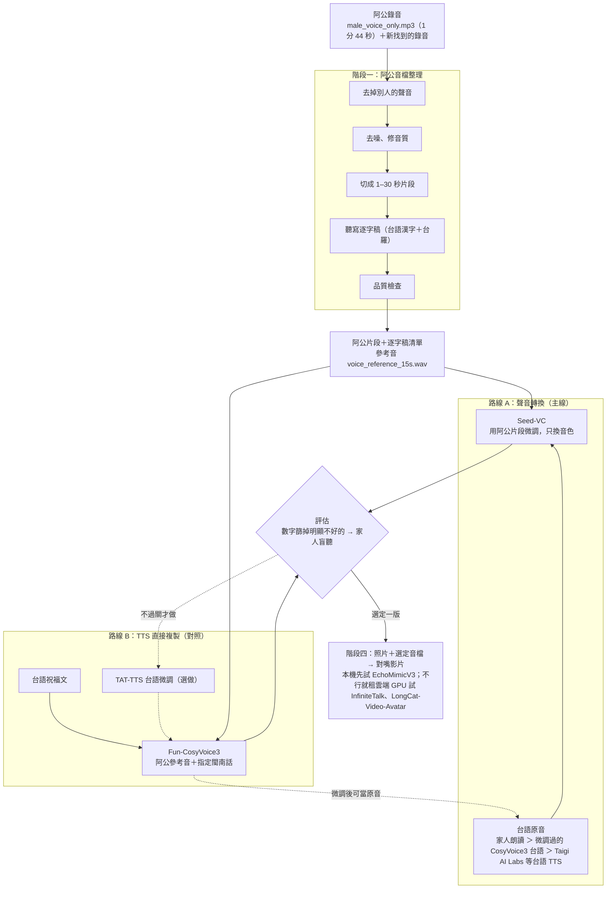

# 阿公台語語音影片：開源模型自建計畫書

Oct 10, 2026 · @Tsai

建議先走「家人或台語 TTS 唸出台語 → Seed-VC 換成阿公音色 → EchoMimicV3 做對嘴影片」這條線，大約一週內就能知道效果；不夠好，再用 TAT-TTS 台語語料微調 CosyVoice3。

## 目標與限制

目標：只用開源模型、在自己的 GPU 上，做出一支 30–40 秒的影片，讓阿公的照片開口，用阿公的聲音講台語祝福。

核心限制是阿公的錄音只有 1 分多鐘，而且不會再增加。所以這份計畫把問題拆成兩半：「會講台灣台語」靠公開台語語料或真人朗讀解決，「聽起來像阿公」只靠這 1 分多鐘解決。

| 素材 | 現況 |
| --- | --- |
| 阿公錄音 | 約 1 分 44 秒（male\_voice\_only.mp3），旁人聲音已去掉；戶外錄、手機在拍攝者那邊，離阿公較遠 |
| 阿公短句參考 | 14 秒最乾淨的連續片段（voice\_reference\_15s.wav；檔名寫 15s，實長 14 秒） |
| 照片 | 一張 |
| 台語文本 | 台語漢字祝福文，約 110 字 |
| 台語原音 | 男聲朗讀 32.8 秒（taiwanese\_source\_joined.wav） |

已試過、但不夠好的做法：

- **ElevenLabs 聲音複製＋Voice Changer**：支援語言沒有台語，參考音又太少，聲音和音調都怪。
- **ElevenLabs Professional Voice Clone**：只能複製本人聲音、要本人錄驗證句、至少 30 分鐘錄音，不可行。
- **MMS 台語 TTS＋kNN-VC（在雲端環境試跑）**：音色相似度 0.60–0.67，同一人兩段錄音互比是 0.92；語調像念稿，不順。

## 整體架構

路線 A 的台語聲調來自原音，最穩；路線 B 不用找人唸，但要接受或修正腔調。兩條都產出後，由評估選一版去做影片。

## 需要準備的資料

最值得花時間的一件事是「再找更多阿公的錄音」：多 1 分鐘乾淨錄音，比換任何模型都有用。台語能力則來自公開語料和一位家人的朗讀。

| 資料 | 用途 | 規格／數量 | 取得方式 |
| --- | --- | --- | --- |
| 阿公錄音（現有） | 音色來源：聲音轉換微調、TTS 參考音 | 1 分 44 秒；切成 1–30 秒的單人片段 | 已有 male\_voice\_only.mp3 |
| 更多阿公錄音 | 提高相似度，最關鍵 | 任何長度都有幫助，有雜音也先收 | LINE 語音訊息、家人手機影片、聚會影片、電話留言 |
| 阿公錄音的逐字稿 | 零樣本複製要參考音的文字；微調要標註 | 台語漢字＋台羅，一段一行 | 人工聽寫；Breeze-ASR-26 只輸出華語意思，可輔助但不能直接用 |
| 台語朗讀原音 | 聲音轉換路線的輸入，決定聲調和語氣 | 年長男性、安靜室內、手機距嘴一個手掌；整段唸一次＋逐句各一次 | 家人錄 |
| [TAT-TTS](https://sites.google.com/nycu.edu.tw/fsw/home/tat-TTS-corpus) | 台語 TTS 微調 | 4 位語者各約 10 小時（2 男 2 女，漳州腔、泉州腔），錄音室 48kHz，附漢羅、台羅、台羅數字調、白話字 | 向計算語言學學會（ACLCLP）申請並簽授權書；用途與費用申請前先向學會確認 |
| [TaigiSpeech](https://huggingface.co/datasets/TaigiSpeech/TaigiSpeech) | 年長者台語語氣的參考與評估 | 21 位 54–78 歲語者，3,079 句，約 6 小時 | 已在 Hugging Face 以 CC BY 4.0 釋出；只有意圖標籤、沒有逐字稿，不能直接訓練 TTS |
| Common Voice 台語（nan-TW） | 補充語料 | 群眾錄音，品質不一，要去噪；內容多為短句或單詞（CC0） | Mozilla Data Collective 帳號下載 |

阿公的片段和朗讀錄音都建一份清單，一個音檔一行：檔名、語者、台語文字。各模型的欄位格式略有不同，照各 repo 的範例轉即可。

## 階段一：阿公音檔整理

產出是一組乾淨的阿公片段（每段 1–30 秒）加一份逐字稿清單，後面每個模型都吃這份。現有的 1 分 44 秒已完成第 1 步，新找到的錄音照同樣流程處理。

1. **去掉別人的聲音**：用說話人分離（這次用的是 pyannote 分段加 3D-Speaker 聲紋；pyannote 模型要登入 Hugging Face 同意條款才能下載）找出阿公的段落，切掉兩人重疊的部分。有背景音樂的影片，先用 GPT-SoVITS 內建的 UVR5 分離人聲。
2. **去噪、修音質**：用 [resemble-enhance](https://github.com/resemble-ai/resemble-enhance)（MIT；指令的輸入輸出都是資料夾），先跑 `--denoise_only`，再跑完整增強，兩版都留著。增強太重會改變音色，所以用聲紋相似度比較哪版比較像原本的阿公。
3. **切句**：在停頓處切成 1–30 秒的片段，1 分 44 秒大約可以切成 10–15 段。另外挑一段 10–20 秒、停頓不超過 2 秒的當參考音（現有的 voice\_reference\_15s.wav 就是）。
4. **聽寫逐字稿**：每段寫下台語漢字和台羅。[Breeze-ASR-26](https://huggingface.co/MediaTek-Research/Breeze-ASR-26) 可以聽台語、寫出華語意思，幫你先知道他在講什麼，台語用字要人工補。
5. **品質檢查**：每段跟全部片段的平均聲紋比相似度，特別低的可能混到別人，拿掉；響度統一到大約 -23 到 -18 LUFS。

## 階段二：產生台語語音的候選模型

建議主線走「聲音轉換」：台語的聲調和語氣交給真人或台語 TTS，阿公的音色交給 Seed-VC。用 TTS 直接複製阿公聲音的路線當對照組，兩條一起跑、用同樣的方式評估。

- **路線 A：聲音轉換（主線）**。台語原音 → Seed-VC（用阿公片段微調）→ 阿公的聲音講台語。語言來自原音，模型只換音色，所以不需要模型會台語。
- **路線 B：TTS 直接複製（對照）**。台語文字 → Fun-CosyVoice3（阿公參考音＋指定閩南話）→ 阿公的聲音講閩南話。不用找人唸，但腔調可能偏中國閩南話，要靠階段三的台語微調修正。

| 模型 | 類型 | 用在哪 | 阿公音檔需求 | 台語 | 授權 |
| --- | --- | --- | --- | --- | --- |
| [Seed-VC](https://github.com/Plachtaa/seed-vc) | 聲音轉換 | 路線 A 主力；v2 模型強調「壓掉原音語者特徵」 | 零樣本 1–30 秒（推論只用參考音前 25 秒）；微調最少 1 句，T4 上 100 步約 2 分鐘 | 不靠模型；README 沒寫語言限制，要實測 | GPL-3.0（程式與權重）；repo 已於 2025 年 11 月封存，安裝時固定套件版本 |
| [RVC](https://github.com/RVC-Project/Retrieval-based-Voice-Conversion-WebUI) | 聲音轉換 | 路線 A 備案 | 建議 10 分鐘以上，1 分 44 秒偏少 | 同上 | MIT |
| [Fun-CosyVoice3-0.5B-2512](https://github.com/FunAudioLLM/CosyVoice) | TTS＋零樣本複製 | 路線 B；也可當路線 A 的台語原音 | 參考音 10–20 秒（百煉建議；開源版上限 30 秒）；零樣本模式要逐字稿，指定閩南話的指令模式不用 | 支援閩南話：`inference_instruct2` 配「请用闽南话表达」（官方只有粵語範例，照同格式），可用台語語料微調 | Apache-2.0 |
| [OmniVoice](https://huggingface.co/k2-fsa/OmniVoice) | TTS＋零樣本複製 | 路線 B 的第二個對照；也可當路線 A 的台語原音 | 參考音（建議同語言） | 訓練資料含閩南語約 17.5 小時，只吃台羅、不吃漢字；有 LoRA 微調文件 | 程式 Apache-2.0；權重 CC-BY-NC（非商用） |
| [GPT-SoVITS](https://github.com/RVC-Boss/GPT-SoVITS) | TTS＋少樣本微調 | 參考：1 分鐘就能微調音色 | 1 分鐘 | 不支援（中英日韓粵），要自己改文字前端 | MIT |
| kNN-VC | 聲音轉換 | 已試過的基準 | 1 分 44 秒 → 相似度 0.67 | 不靠模型 | — |

路線 A 的台語原音，優先順序是：年長男性家人朗讀 > 微調過的 CosyVoice3 台語 > Taigi AI Labs 等台語 TTS。聲音轉換會保留原音的速度和語氣，所以原音越像阿公講話的樣子，結果越像他。

## 階段三：訓練與微調步驟

要訓練的有兩件事，完全分開：用阿公的片段微調 Seed-VC（幾分鐘就能跑完），以及用 TAT-TTS 微調 CosyVoice3 讓它講台灣台語（幾天的工作量）。先做第一件，第二件等確定需要再做。

**1. Seed-VC：阿公音色微調（路線 A，先做）**

1. 把階段一切好的阿公片段放進一個資料夾。每段要在 1–30 秒之間，超出範圍的會被跳過。
2. 先不訓練，直接用零樣本轉一次：台語原音（taiwanese\_source\_joined.wav）配 voice\_reference\_15s.wav，得到基準版。
3. 照 README 的微調指令訓練，先跑 100–500 步。資料只有 1 分多鐘，步數太多容易過擬合、出現怪音，每個存檔點都拿來轉同一段台語比較。
4. v1（seed-uvit-whisper-small-wavenet）和 v2（hubert-bsqvae-small）各訓一次。v2 預設（`--convert-style false`）只換音色；設 `true` 才會用 AR 模型改腔調和情緒，開 true 的版本要特別確認台語聲調沒有被改壞。
5. 用「評估方式」一節的方法評估，留下最好的存檔點。

**2. CosyVoice3：台灣台語微調（路線 B，選做）**

1. 向 ACLCLP 申請 TAT-TTS。先聽兩位男聲（M1：34 歲、偏漳州腔；M2：55 歲、泉州安溪腔），挑腔調接近阿公的那位。
2. 模型輸入用 TAT 附的「漢羅台文」，跟你之後寫稿的方式一致；台羅留著檢查發音。
3. 微調 LLM 和 Flow，HiFi-GAN 聲碼器不動。有人用約 2,100 句德語方言微調 CosyVoice3，回報連聲碼器一起微調會出現雜音。
4. 只用一位語者微調，模型會變成那位語者的聲音、失去零樣本複製能力。這沒關係：把它當成「會講道地台語的男聲」，輸出再丟給 Seed-VC 換成阿公，就不用找人唸。

GPT-SoVITS 雖然 1 分鐘就能微調，但文字前端只支援中英日韓粵，台語漢字會照華語唸，除非要自己接台羅音標前端，否則不建議。

## 階段四：照片變成會說話的影片

你的 RTX 3070 只有 8GB，最省資源的 EchoMimicV3 也要 12GB。先在本機試：把 partial\_video\_length 調到 65 或更小，看能不能跑；跑不動就租一張 24GB 以上的雲端 GPU，順便試 InfiniteTalk 或 LongCat-Video-Avatar 1.5，挑最像阿公的一支。只想先看效果的話，這一步也可以先用 Hedra 這類線上服務。這些模型都是聽音檔動嘴，README 沒寫語言限制，但音訊編碼器是用華語或多語資料訓練（chinese-wav2vec2-base 或 Whisper-large-v3），台語音檔可以直接用，對嘴準不準要實測。

| 模型 | 解析度／長度 | 硬體 | 授權 | 備註 |
| --- | --- | --- | --- | --- |
| [EchoMimicV3](https://github.com/antgroup/echomimic_v3) | 最高 768×768；超過 138 幀用長影片設定 | Flash 版 12GB，ComfyUI 版 16GB | Apache 2.0 | 1.3B，最省資源 |
| [InfiniteTalk](https://github.com/MeiGen-AI/InfiniteTalk) | 480P／720P；預設上限 40 秒，照片模式 1 分鐘內效果好 | 基於 Wan2.1 14B；README 沒寫顯存，有 fp8 量化和低顯存選項 | Apache 2.0 | 祝福影片 30–40 秒剛好在範圍內 |
| [LongCat-Video-Avatar 1.5](https://github.com/meituan-longcat/LongCat-Video) | 480P／720P；可續接延長 | 13.6B 基座；範例用 2 張 GPU，有 INT8 | MIT（權重） | 2026 年 5 月發布，音訊編碼器換成 Whisper-large-v3 |
| [Wan2.2-S2V-14B](https://github.com/Wan-Video/Wan2.2) | 480P／720P；長度跟著音檔 | 單卡至少 80GB | Apache 2.0 | 資源需求最大 |

照片先整理：選正面、光線均勻、嘴巴閉著或微張的，裁成半身。老照片或解析度低的，先用 CodeFormer 或 GFPGAN 這類開源工具修臉再丟進去。

## 評估方式

最後由家人盲聽決定，數字只用來篩掉明顯不好的版本，省下大家的時間。每個版本都用同一段台語稿產生，才能比較。

| 面向 | 方法 | 怎樣算好 |
| --- | --- | --- |
| 音色像不像 | 聲紋模型（如 3D-Speaker）算餘弦相似度，跟阿公錄音的前後半段各比一次 | 同一人基準是 0.92，已試的 kNN-VC 是 0.67；要明顯高於 0.67 |
| 台語對不對 | 會講台語的家人逐句聽，圈出唸錯或聲調怪的字；可輔助用 Breeze-ASR-26 轉成華語，看意思有沒有跑掉 | 每句都聽得懂、沒有唸錯的字 |
| 順不順 | 量音高突然跳動的比例、特別大聲的字（這次試跑用過的檢查） | 不高於阿公本人錄音的水準 |
| 對嘴 | SyncNet 的 LSE-C／LSE-D 分數＋人眼看嘴型和聲音有沒有對上 | 逐幀看沒有明顯脫節 |
| 整體 | 家人盲聽：不說是哪個版本，兩兩一組選「比較像阿公」的 | 多數人選的版本勝出 |

## 硬體需求與時程

語音部分一張消費級 GPU 就夠；影片部分決定你需要多大的卡。你的 RTX 3070（8GB）跑得動整個語音部分（路線 A）；CosyVoice3 微調和影片模型要租按小時計費的雲端 GPU。標「估計」的是 README 沒寫、我依模型大小推的，要實測。

| 工作 | 顯存 | 你的 RTX 3070（8GB） | 依據 |
| --- | --- | --- | --- |
| 音檔整理（去噪、說話人分離） | 小，一般 GPU 即可 | 可以 | 估計 |
| Breeze-ASR-26 聽寫輔助 | 約 15 億參數（Whisper-large-v2 微調），F32 權重約 6.2GB；fp16 約 3.1GB | 可以（fp16） | model card；Apache-2.0 |
| Seed-VC 微調與推論 | 消費級 GPU | 可以，微調時把批次調小 | README：T4 微調 100 步約 2 分鐘；即時轉換效能測試用 RTX 3060 筆電；未寫顯存需求 |
| CosyVoice3 0.5B 推論 | 消費級 GPU | 應該可以 | 估計（0.5B 參數） |
| CosyVoice3 台語微調 | 24GB 以上 | 不夠，租雲端 GPU | 估計 |
| EchoMimicV3 | 12GB | 不夠；先試調小 partial\_video\_length，不行就租 | README |
| InfiniteTalk／LongCat-Video-Avatar | 24GB 以上配合 fp8／INT8，或多卡 | 不行，租雲端 GPU | 估計（14B 級模型） |
| Wan2.2-S2V-14B | 80GB | 不行 | README |

TAT-TTS 要申請、等審核，第一天就先送出，跟其他工作並行。

| 時間 | 階段 | 要做的事 | 產出／關卡 |
| --- | --- | --- | --- |
| 第 1 天 | 準備 | 向 ACLCLP 送出 TAT-TTS 申請；等審核期間其他工作照常進行 | 申請已送出 |
| 第 1 週 | 階段一：阿公音檔整理 | 去掉別人的聲音 → 去噪 → 切成 1–30 秒片段 → 聽寫逐字稿 → 品質檢查；同時繼續找阿公錄音、請家人錄台語朗讀 | 阿公片段＋逐字稿清單 |
| 第 1 週 | 階段二＋三：路線 A（主線），路線 B 當對照 | Seed-VC 零樣本基準 → 微調 100–500 步（v1、v2 各一次），每個存檔點都轉同一段台語來比較；CosyVoice3 零樣本產生對照版 | 各版台語音檔＋評估數字 |
| 約第 1 週結束 | **決策關卡：家人盲聽** | 不說是哪個版本，兩兩一組選「比較像阿公」的 | 過關 → 直接做影片；不過關 → 台語微調 |
| 再加 1–2 週（只有不過關才做） | 階段三：CosyVoice3 台灣台語微調 | 用 TAT-TTS 微調 LLM 和 Flow（聲碼器不動），輸出再丟給 Seed-VC 換成阿公，回到評估 | 新一版台語音檔 |
| 盲聽過關後 | 階段四：照片變成會說話的影片 | 照片整理 → 本機試 EchoMimicV3（調小 partial_video_length）；跑不動就租雲端 GPU 試 InfiniteTalk／LongCat-Video-Avatar 1.5 | 30–40 秒影片 |

路線 A 大約一週內就能知道行不行；只有家人盲聽不過關，才需要花一兩週做台語微調。

## 風險與注意事項

最大的風險是素材上限：只靠 1 分 44 秒的戶外錄音，不管模型多好，音色都可能卡在「有點像」。

| 風險 | 應對 |
| --- | --- |
| 阿公錄音太少、戶外離麥克風遠 | 優先找更多錄音；去噪版和原版都拿去微調比較 |
| CosyVoice3 的閩南話偏中國腔 | 用 TAT-TTS 微調，或改走真人朗讀＋聲音轉換 |
| 聲音轉換把台語聲調改壞 | 每版都請會台語的家人逐句聽；Seed-VC v2 開 `--convert-style true` 時會改腔調，特別要檢查 |
| 小資料微調過擬合 | 少步數開始，每個存檔點都評估 |
| 授權 | TAT-TTS 要簽協議，用途與費用以協議為準（申請前先確認）；Seed-VC 是 GPL-3.0，CosyVoice3 是 Apache-2.0，RVC／GPT-SoVITS／resemble-enhance 是 MIT；MMS 台語 TTS、CodeFormer、OmniVoice 權重只限非商用 |

這是家人的紀念影片：先取得主要家人的同意，先給少數人看過再擴大分享。公開分享時寫明「以 AI 生成」，不要說成是阿公生前的錄音。

## 參考資料

- [Seed-VC（GitHub）](https://github.com/Plachtaa/seed-vc)
- [Fun-CosyVoice3／CosyVoice（GitHub）](https://github.com/FunAudioLLM/CosyVoice)
- [CosyVoice3 德語方言微調案例（Hugging Face）](https://huggingface.co/Thorsten-Voice/CosyVoice3-Hessisch)
- [阿里雲百煉：語音合成模型方言支援](https://help.aliyun.com/zh/model-studio/tts-model)
- [GPT-SoVITS（GitHub）](https://github.com/RVC-Boss/GPT-SoVITS)
- [RVC（GitHub）](https://github.com/RVC-Project/Retrieval-based-Voice-Conversion-WebUI)
- [resemble-enhance（GitHub）](https://github.com/resemble-ai/resemble-enhance)
- [Breeze-ASR-26（Hugging Face）](https://huggingface.co/MediaTek-Research/Breeze-ASR-26)
- [TAT-TTS 語料庫](https://sites.google.com/nycu.edu.tw/fsw/home/tat-TTS-corpus)
- [TaigiSpeech 論文](https://arxiv.org/html/2603.21478v1)、[TaigiSpeech 資料集（Hugging Face）](https://huggingface.co/datasets/TaigiSpeech/TaigiSpeech)
- [OmniVoice（Hugging Face）](https://huggingface.co/k2-fsa/OmniVoice)
- [全球與台灣語音資料集（HackMD）](https://hackmd.io/@sheep52031/BJaM4borWg)
- [EchoMimicV3（GitHub）](https://github.com/antgroup/echomimic_v3)
- [InfiniteTalk（GitHub）](https://github.com/MeiGen-AI/InfiniteTalk)
- [LongCat-Video（GitHub）](https://github.com/meituan-longcat/LongCat-Video)
- [Wan2.2（GitHub）](https://github.com/Wan-Video/Wan2.2)
- [ElevenLabs Professional Voice Cloning](https://elevenlabs.io/docs/creative-platform/voices/voice-cloning/professional-voice-cloning)
