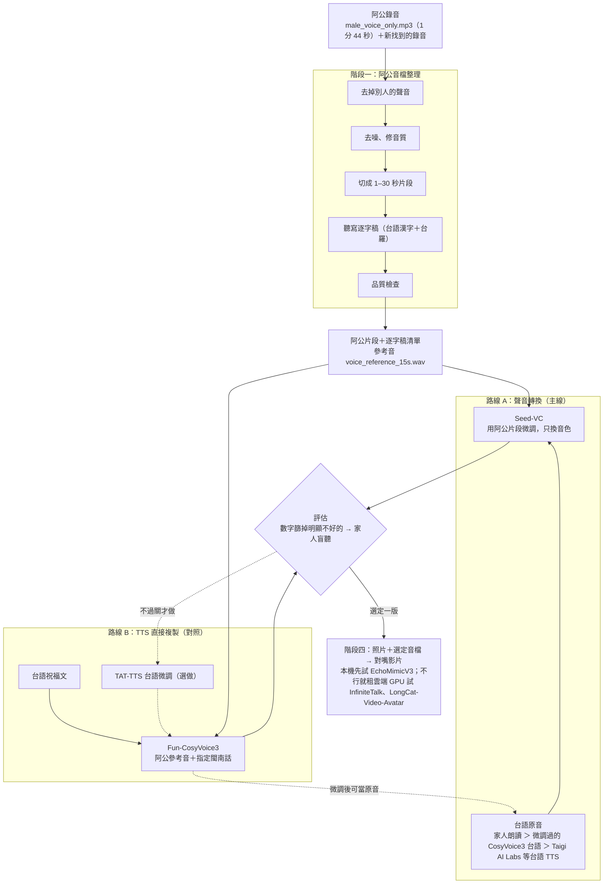

# 計畫書查證報告

對象：`阿公台語語音影片：開源模型自建計畫書.md`（2026 年 10 月 10 日版；與 `docs/計畫書_原始備份.md` 內容相同）
查證日期：2026 年 10 月 10–11 日｜查證者：doc-research｜方法：只看第一手來源（GitHub README／LICENSE／原始碼、Hugging Face model card、arXiv、官方頁面）。行號指計畫書的行號。

標記：✅ 正確｜⚠️ 需修正或補充｜❓ 查不到第一手資料

---

## 0. 最重要的修正（給 lead 先看）

1. **授權已查到，表格與風險表要改**：Seed-VC 是 **GPL-3.0**（程式與 HF 權重都是）；CosyVoice／Fun-CosyVoice3 是 **Apache-2.0**；RVC、GPT-SoVITS、resemble-enhance 都是 **MIT**。（L68–70、L153）
2. **Seed-VC repo 已在 2025-11-21 封存（唯讀）**，不會再更新；可以用，但安裝時要固定套件版本。
3. **「v2 會改腔調」要改寫**：v2 預設 `--convert-style false` 只換音色（README：等同 V1）；要設 `true` 才會用 AR 模型做「accent & emotion conversion」。（L85、L151）
4. **Breeze-ASR-26 的大小寫錯**：實際約 15.4 億參數（HF 頁面四捨五入顯示 2B），F32 權重 **6.2GB**（不是 8GB）；fp16 約 3.1GB。（L129）
5. **TaigiSpeech 已釋出**（Hugging Face，CC BY 4.0），但**只有意圖標籤、沒有逐字稿**，不能拿來訓練 TTS。（L44）
6. **CosyVoice3 參考音「10–20 秒」不是開源 README 的說法**，而是阿里雲百煉雲端服務的建議；開源程式碼硬性上限 30 秒。閩南話指令官方只有粵語範例，需照同格式類推。（L70）
7. **TAT-TTS 細節**：M1 是 34 歲「偏漳州腔」、M2 是 55 歲「泉州安溪腔」；原連結頁面已標示搬到新網址。（L43、L90）
8. 新選項：**OmniVoice**（2026-04，k2-fsa）訓練資料含閩南語，台羅輸入、零樣本複製，但權重非商用；可當路線 B 的另一個對照。
9. 錯字：L119「脱節」→「脫節」、L120「胝出」→「勝出」。

---

## 1. 逐條查證

### 1.1 Seed-VC

| # | 原文（行號） | 查證結果 | 來源 | 建議改寫 |
| --- | --- | --- | --- | --- |
| S1 | 授權「README 未寫，用前查 LICENSE」（L68、L153） | ⚠️ LICENSE 檔是 **GNU GPL v3**；HF 權重 `Plachta/Seed-VC` 也標 `gpl-3.0`。另：GitHub 顯示「This repository was archived by the owner on Nov 21, 2025. It is now read-only.」 | [LICENSE](https://github.com/Plachtaa/seed-vc/blob/main/LICENSE)、[HF 權重](https://huggingface.co/Plachta/Seed-VC)、[repo 首頁](https://github.com/Plachtaa/seed-vc) | 「GPL-3.0（程式與權重）。repo 已於 2025 年 11 月封存，不再更新，安裝時固定套件版本。」（GPL 不影響家用影片；只有修改程式再散布才需開源） |
| S2 | v1（whisper-small-wavenet）、v2（hubert-bsqvae-small）（L85） | ✅ README 模型表：v1.0 `seed-uvit-whisper-small-wavenet`（"suitable for offline voice conversion"）；v2.0 `hubert-bsqvae-small`（"Voice & Accent Conversion"） | [README](https://github.com/Plachtaa/seed-vc/blob/main/README.md) | 可寫全名 `seed-uvit-whisper-small-wavenet`，方便對照設定檔 |
| S3 | 「T4 上 100 步約 2 分鐘」（L68、L130） | ✅ README 原句：「minimum 100 steps, 2 min on T4」 | 同上 | 不用改 |
| S4 | 「微調最少 1 句」（L68） | ✅ README：「minimum 1 utterance per speaker」 | 同上 | 不用改 |
| S5 | 「零樣本 1–30 秒」「每段要在 1–30 秒之間，超出範圍的會被跳過」（L68、L82） | ✅ README：參考音「1~30 seconds」；訓練資料「Each audio file should range from 1 to 30 seconds, otherwise will be ignored」；程式 `data/ft_dataset.py` 的 `min 1.0 / max 30.0`。補充：推論時參考音只取前 25 秒（v1 `inference.py` 的 `ref_audio[:sr * 25]`；v2 `vc_wrapper.py` 註解「Limit target audio to 25 seconds」） | [README](https://github.com/Plachtaa/seed-vc/blob/main/README.md)、[ft_dataset.py](https://github.com/Plachtaa/seed-vc/blob/main/data/ft_dataset.py)、[inference.py](https://github.com/Plachtaa/seed-vc/blob/main/inference.py) | 可補一句「推論時參考音只用前 25 秒」；14 秒的 voice_reference_15s.wav 不受影響 |
| S6 | v2「壓掉原音語者特徵」（L68） | ✅ README：「Best in suppressing source speaker traits」 | [README](https://github.com/Plachtaa/seed-vc/blob/main/README.md) | 不用改 |
| S7 | 「v2 會改腔調，要確認台語聲調沒有被改壞」（L85、L151） | ⚠️ 只有開 `--convert-style true` 才會改：README 說此參數「whether to use AR model for accent & emotion conversion」，設 false 時只換音色、類似 V1。`inference_v2.py` 預設是 `False` | [README](https://github.com/Plachtaa/seed-vc/blob/main/README.md)、[inference_v2.py](https://github.com/Plachtaa/seed-vc/blob/main/inference_v2.py) | 「v2 預設（`--convert-style false`）只換音色；設 `true` 才會用 AR 模型改腔調和情緒。兩種都試，開 true 的版本特別檢查台語聲調。」 |
| S8 | 「README 沒寫語言限制，要實測」（L68） | ✅ README 沒寫語音語言限制 | 同上 | 不用改 |
| S9 | 「推論範例用 RTX 3060 筆電」（L130） | ⚠️ 原句在「即時轉換 GUI」段落：「Some performance testing has been done on a NVIDIA RTX 3060 Laptop GPU」，是即時轉換的效能測試，不是離線推論範例；README 沒寫顯存。訓練段落另寫 batch-size「depends on your GPU memory」、Windows 要設 `--num-workers 0` | 同上 | 「README：T4 微調 100 步約 2 分鐘；即時轉換效能測試用 RTX 3060 筆電；未寫顯存需求」 |

### 1.2 RVC、GPT-SoVITS、resemble-enhance

| # | 原文（行號） | 查證結果 | 來源 | 建議改寫 |
| --- | --- | --- | --- | --- |
| R1 | RVC「建議 10 分鐘以上」（L69） | ✅ README：「推荐至少收集10分钟低底噪语音数据」（同句也說少量資料也能有不錯結果） | [README](https://github.com/RVC-Project/Retrieval-based-Voice-Conversion-WebUI/blob/main/README.md) | 不用改 |
| R2 | RVC 授權「用前查 LICENSE」（L69） | ⚠️ LICENSE 是 **MIT** | [LICENSE](https://github.com/RVC-Project/Retrieval-based-Voice-Conversion-WebUI/blob/main/LICENSE) | 「MIT」 |
| G1 | GPT-SoVITS 授權 MIT（L71） | ✅ LICENSE：MIT（Copyright 2024 RVC-Boss） | [LICENSE](https://github.com/RVC-Boss/GPT-SoVITS/blob/main/LICENSE) | 不用改 |
| G2 | 「不支援（中英日韓粵）」（L71、L95） | ✅ README：推論「currently supporting English, Japanese, Korean, Cantonese and Chinese」；資料語言代碼只有 zh/ja/en/ko/yue | [README](https://github.com/RVC-Boss/GPT-SoVITS/blob/main/README.md) | 不用改 |
| G3 | 「1 分鐘就能微調」（L71、L95） | ✅ README：「Fine-tune the model with just 1 minute of training data」 | 同上 | 不用改 |
| G4 | 「GPT-SoVITS 內建的 UVR5」（L53） | ✅ README 列有「UVR5 (Vocals/Accompaniment Separation & Reverberation Removal…)」 | 同上 | 不用改 |
| E1 | resemble-enhance `--denoise_only`（L54） | ✅ README：「resemble-enhance in_dir out_dir --denoise_only」。授權 **MIT**（計畫書沒寫，可補）。注意指令吃的是「資料夾」，模型以 44.1kHz 語音訓練 | [README](https://github.com/resemble-ai/resemble-enhance/blob/main/README.md)、[LICENSE](https://github.com/resemble-ai/resemble-enhance/blob/main/LICENSE) | 可補「（MIT；指令輸入輸出都是資料夾）」 |

### 1.3 Fun-CosyVoice3 與相關說法

| # | 原文（行號） | 查證結果 | 來源 | 建議改寫 |
| --- | --- | --- | --- | --- |
| C1 | Fun-CosyVoice3-0.5B-2512 是否存在（L70） | ✅ HF 有此模型；README Roadmap「2025/12 release Fun-CosyVoice3-0.5B-2512 base model, rl model and its training/inference script」 | [HF model card](https://huggingface.co/FunAudioLLM/Fun-CosyVoice3-0.5B-2512)、[README](https://github.com/FunAudioLLM/CosyVoice/blob/main/README.md) | 不用改 |
| C2 | 授權「README 未寫，用前查」（L70、L153） | ⚠️ repo LICENSE 是 **Apache-2.0**；model card metadata 也是 `apache-2.0` | [LICENSE](https://github.com/FunAudioLLM/CosyVoice/blob/main/LICENSE)、[HF](https://huggingface.co/FunAudioLLM/Fun-CosyVoice3-0.5B-2512) | 「Apache-2.0」 |
| C3 | 「支援閩南話（指令控制）」（L70、L64） | ⚠️ 支援是對的：README「18+ Chinese dialects/accents (Guangdong, Minnan, Sichuan…)」，且「Supports various instructions such as languages, dialects…」。但官方範例只有粵語：`inference_instruct2(文字, 'You are a helpful assistant. 请用广东话表达。<\|endofprompt\|>', 參考音)`；閩南話沒有官方範例。第三方資料集 tw-hokkien-audio 用的是同格式的「请用闽南话表达」 | [README](https://github.com/FunAudioLLM/CosyVoice/blob/main/README.md)、[example.py](https://github.com/FunAudioLLM/CosyVoice/blob/main/example.py)、[tw-hokkien-audio](https://huggingface.co/datasets/lianghsun/tw-hokkien-audio) | 「支援閩南話：用 `inference_instruct2`，指令寫 `You are a helpful assistant. 请用闽南话表达。<\|endofprompt\|>`（官方只有粵語範例，閩南話照同格式，要實測）」 |
| C4 | 「參考音 10–20 秒＋逐字稿」（L70） | ⚠️ 開源 README／model card 沒有建議長度。「10~20 秒，最長不超過 60 秒」是阿里雲百煉（雲端）聲音複刻文件的建議；開源程式 `frontend.py` 有硬性上限：「do not support extract speech token for audio longer than 30s」。另外：零樣本 `inference_zero_shot` 才需要參考音逐字稿，且要以 `You are a helpful assistant.<\|endofprompt\|>` 開頭；指令模式 `inference_instruct2` 只吃參考音、不用逐字稿 | [百煉聲音複刻文件](https://www.alibabacloud.com/help/zh/model-studio/voice-cloning-user-guide)、[frontend.py](https://github.com/FunAudioLLM/CosyVoice/blob/main/cosyvoice/cli/frontend.py)、[example.py](https://github.com/FunAudioLLM/CosyVoice/blob/main/example.py) | 「參考音 10–20 秒（百煉建議；開源版上限 30 秒）；零樣本模式要逐字稿，指定閩南話的指令模式不用」 |
| C5 | 「可用台語語料微調」（L70） | ✅ Roadmap 寫明釋出 training script；README：「training and inference scripts in examples/libritts」；Thorsten-Voice 已有方言微調實例 | [README](https://github.com/FunAudioLLM/CosyVoice/blob/main/README.md) | 不用改 |
| C6 | 德語方言微調「約 2,100 句」「連聲碼器一起微調會出現雜音」「微調 LLM 和 Flow」（L92） | ✅ model card：「~2,100 Hessian-dialect recordings, single speaker, 24kHz」；微調「LLM」與「Flow」；「fine-tuning HiFi-GAN on this comparatively small dataset degraded audio quality (audible artifacts)」；基底就是 Fun-CosyVoice3-0.5B-2512，Apache-2.0。硬體與訓練時間沒寫 | [Thorsten-Voice/CosyVoice3-Hessisch](https://huggingface.co/Thorsten-Voice/CosyVoice3-Hessisch) | 可補「單一語者、24kHz」 |
| C7 | 阿里雲百煉方言支援頁（L162） | ✅ 頁面列出 cosyvoice-v3.5-plus／flash、v3-plus、v3-flash 的「声音复刻音色（方言通过指令控制功能进行设置）」含**闽南话**；v3-flash 系統音色、qwen3-tts-flash 系統音色也含闽南话。注意：這是雲端商用 API，不等於開源 0.5B 的能力 | [百煉語音合成頁](https://help.aliyun.com/zh/model-studio/tts-model) | 參考資料可加註「雲端版，僅供對照」 |
| C8 | 「CosyVoice3 的閩南話偏中國腔」「CosyVoice3 台語微調 24GB 以上」（L64、L132、L150） | ❓ 找不到第一手評測或硬體數據；Thorsten 頁面也沒寫硬體。計畫書已標「估計」，維持即可 | — | 不用改（保留「估計」） |

### 1.4 Breeze-ASR-26

| # | 原文（行號） | 查證結果 | 來源 | 建議改寫 |
| --- | --- | --- | --- | --- |
| B1 | 「2B 參數，F32 權重約 8GB」「用半精度應可」（L129） | ⚠️ HF 頁面顯示「2B params, F32」是四捨五入；`model.safetensors.index.json` 的 total_size = 6,173,219,840 bytes（兩個分片 4.99GB＋1.18GB），F32 換算約 **15.4 億參數**，是 openai/whisper-large-v2 的微調。fp16 約 3.1GB，8GB 卡可跑 | [HF model card](https://huggingface.co/MediaTek-Research/Breeze-ASR-26)、[檔案列表](https://huggingface.co/MediaTek-Research/Breeze-ASR-26/tree/main) | 「約 15 億參數（Whisper-large-v2 微調），F32 權重約 6.2GB；fp16 約 3.1GB，RTX 3070 可以」 |
| B2 | 授權（計畫書未寫） | ✅ 補充：model card「released under the Apache 2.0 License」；2026-04-14 開源（陽明交大新聞） | [HF](https://huggingface.co/MediaTek-Research/Breeze-ASR-26)、[NYCU SARC 新聞](https://sites.google.com/nycu.edu.tw/sarc/news) | 可補「Apache-2.0」 |
| B3 | 「只輸出華語意思」（L41、L56、L117） | ✅ model card：從台語語音「outputs **Mandarin Chinese character** transcriptions」 | [HF](https://huggingface.co/MediaTek-Research/Breeze-ASR-26) | 不用改 |

### 1.5 資料集

| # | 原文（行號） | 查證結果 | 來源 | 建議改寫 |
| --- | --- | --- | --- | --- |
| T1 | TAT-TTS「4 位語者各約 10 小時（2 男 2 女，漳州腔、泉州腔）」（L43） | ✅ 頁面：「台語強勢腔（漳州腔,#1）與次強勢腔（泉州腔,#2）」，每腔一男一女；M1 約 10.4h、M2 約 10.1h、F1 約 10h、F2 約 10.1h | [TAT-TTS 頁面](https://sites.google.com/speech.ntut.edu.tw/fsw/home/tat-tts-corpus) | 不用改 |
| T2 | 「先聽兩位男聲（M1 漳州腔、M2 泉州腔）」（L90） | ⚠️ 頁面：M1 男 34 歲「偏漳州腔」；M2 男 55 歲「泉州安溪腔」。年齡對挑「像阿公」有參考價值 | 同上 | 「M1（34 歲，偏漳州腔）、M2（55 歲，泉州安溪腔）」 |
| T3 | 「錄音室 48kHz」（L43） | ✅ 專業錄音室；WAV 單聲道 48000 Hz、24-bit PCM | 同上 | 不用改 |
| T4 | 「附漢羅、台羅、白話字」（L43、L91） | ✅ 每個音檔附同名 JSON，欄位含「漢羅台文」「台羅」「台羅數字調」「白話字」，另有發音人、年齡、腔調等 | 同上 | 可補「台羅數字調」 |
| T5 | 「向 ACLCLP 申請並簽授權書」（L43、L90） | ✅ 頁面：「上列語料庫已經由臺北科技大學授權社團法人中華民國計算語言學學會發行，申請人需向學會提出申請，簽妥授權使用協議書」；國內申請入口 `aclclp.org.tw/use_mat_c.php#tat` | 同上 | 不用改 |
| T6 | 「用途限制以協議為準」（L153） | ❓ ACLCLP 網站有 Cloudflare 驗證，無法直接讀 TAT-TTS 授權書與費用。搜尋到的 TAT 系列協議書寫「僅能…使用於學術研究、教育或公益用途，不得以此牟利或從事商業行為」，但未確認是否就是 TAT-TTS 那份 | [ACLCLP 國內授權頁](http://www.aclclp.org.tw/use_mat_c.php#tat) | 「申請前先向學會確認：用途（家庭紀念影片）是否符合協議、費用多少」 |
| T7 | TAT-TTS 連結（L43、L167） | ⚠️ 原頁面標示「This webpage had been moved to https://sites.google.com/nycu.edu.tw/fsw/home/tat-TTS-corpus」，新頁面內容相同 | [新網址](https://sites.google.com/nycu.edu.tw/fsw/home/tat-TTS-corpus) | 連結換成新網址 |
| TS1 | TaigiSpeech「21 位 54–78 歲語者，3,079 句，約 6 小時」（L44） | ✅ 論文：21 位（13 女 8 男），54–78 歲（平均 67.9），3,079 句，366.91 分鐘（約 6.1 小時；內文另寫約 6.3 小時），48kHz、安靜室內 | [arXiv 2603.21478](https://arxiv.org/html/2603.21478v1) | 不用改 |
| TS2 | 「論文說以 CC BY 4.0 公開，需確認是否已釋出」（L44） | ⚠️ **已釋出**：Hugging Face `TaigiSpeech/TaigiSpeech`，`cc-by-4.0`，2.11GB，train/val/test = 1,600/519/960。但欄位只有 `audio`、`speaker_id`、`intent`（8 類求救／居家指令意圖），**沒有逐字稿**。論文 v2 為 2026-06-20，Interspeech 2026 | [HF 資料集](https://huggingface.co/datasets/TaigiSpeech/TaigiSpeech)、[arXiv abs](https://arxiv.org/abs/2603.21478) | 「已在 Hugging Face 以 CC BY 4.0 釋出；只有意圖標籤、沒有逐字稿，只適合當年長者語氣參考或評估樣本，不能直接訓練 TTS」 |
| CV1 | Common Voice 台語「Mozilla Data Collective 帳號下載」（L45） | ✅ Mozilla 官方 README：「Effective October 2025, Mozilla Common Voice datasets will be exclusively made available through Mozilla Data Collective」，需建帳號並同意新條款。MDC 上有「Common Voice Scripted Speech 25.0 - Taiwanese (Minnan)」（CC0-1.0）；未登入時 API 回「Access to this dataset has not been granted」。搜尋摘要顯示頁面說明台語語料仍以單詞為主（頁面動態載入，未能直接確認） | [Mozilla README](https://huggingface.co/spaces/mozilla-foundation/README/blob/main/README.md)、[MDC 台語資料集](https://mozilladatacollective.com/datasets/cmn2cyd8901jemm0738nubysq) | 可補「CC0；內容多為短句或單詞」 |

### 1.6 影片模型

| # | 原文（行號） | 查證結果 | 來源 | 建議改寫 |
| --- | --- | --- | --- | --- |
| V1 | EchoMimicV3「Flash 版 12GB，ComfyUI 版 16GB」（L99、L103、L133） | ✅ Flash：「12G VRAM Requirement」；2025-08-12：「12G VRAM is All YOU NEED」（指向 `app_mm.py`）、「can run on 16G VRAM using ComfyUI」（第三方 smthemex/ComfyUI_EchoMimic） | [README](https://github.com/antgroup/echomimic_v3/blob/main/README.md) | 可補「ComfyUI 版為第三方節點」 |
| V2 | 「最高 768×768」（L103） | ✅ Flash：「Supports up to 768×768 Resolution」 | 同上 | 不用改 |
| V3 | 「partial_video_length 調到 65 或更小」（L99、L133） | ✅ Tips：「Try setting `partial_video_length` to 81, 65 or smaller to reduce VRAM usage」 | 同上 | 不用改 |
| V4 | 「超過 138 幀用長影片設定」（L103） | ✅ Tips：「If you want to generate a video longer than 138 frames, you can use Long Video CFG」 | 同上 | 可寫成「Long Video CFG」 |
| V5 | 「Apache 2.0」「1.3B」（L103） | ✅ README：「The models in this repository are licensed under the Apache 2.0 License」；GitHub 授權 Apache-2.0；基底 Wan2.1-Fun-V1.1-1.3B-InP。Flash 的音訊編碼器是 chinese-wav2vec2-base | 同上 | 不用改 |
| V6 | InfiniteTalk「480P／720P；預設上限 40 秒，照片模式 1 分鐘內效果好；基於 Wan2.1 14B；README 沒寫顯存，有 fp8 量化和低顯存選項；Apache 2.0」（L104） | ✅ 全部對得上：「--max_frame_num … default is 40 seconds(1000 frames)」；單張圖「up to 1 minute」，超過色偏明顯；基底 Wan2.1-I2V-14B-480P；`--quant fp8`、`--num_persistent_param_in_dit 0`；Apache 2.0。音訊編碼器 chinese-wav2vec2-base | [README](https://github.com/MeiGen-AI/InfiniteTalk/blob/main/README.md) | 不用改 |
| V7 | LongCat-Video-Avatar 1.5「2026 年 5 月發布、13.6B 基座、範例 2 張 GPU、INT8、MIT（權重）、Whisper-large-v3」（L105） | ✅ 「May 21, 2026: We release LongCat-Video-Avatar-1.5」；基座「13.6B parameters」；範例都是 `--nproc_per_node=2`；`--use_int8`；「The model weights are released under the MIT License」；v1.5「Whisper-large-v3 audio encoder」 | [README](https://github.com/meituan-longcat/LongCat-Video/blob/main/README.md) | 不用改 |
| V8 | Wan2.2-S2V-14B「單卡至少 80GB；Apache 2.0；長度跟著音檔」（L106、L135） | ✅ 「This command can run on a GPU with at least 80GB VRAM」（已含 `--offload_model True --convert_model_dtype`）；Apache 2.0；不設 `--num_clip` 時長度跟著音檔；2025-08-26 發布 | [README](https://github.com/Wan-Video/Wan2.2/blob/main/README.md) | 不用改 |
| V9 | 「這些模型都是聽音檔動嘴，不看語言」（L99） | ⚠️ README 都沒寫語言限制，但音訊編碼器是 chinese-wav2vec2-base（EchoMimicV3、InfiniteTalk）或 Whisper-large-v3（LongCat 1.5），都不是針對台語訓練 | 同上 | 「README 沒寫語言限制，但音訊編碼器是用華語或多語資料訓練，台語對嘴要實測」 |

### 1.7 已試過的服務與其他授權

| # | 原文（行號） | 查證結果 | 來源 | 建議改寫 |
| --- | --- | --- | --- | --- |
| EL1 | ElevenLabs PVC「只能複製本人聲音、要本人錄驗證句、至少 30 分鐘」（L24） | ✅ 「For now, we only allow you to clone your own voice」；送出前要通過 verification（逐行朗讀驗證句）；「The bare minimum we recommend is 30 minutes of audio」，最佳 2–3 小時；Free／Starter 方案沒有 PVC | [ElevenLabs PVC 文件](https://elevenlabs.io/docs/creative-platform/voices/voice-cloning/professional-voice-cloning) | 「官方建議最少 30 分鐘（最佳 2–3 小時）」 |
| EL2 | 「支援語言沒有台語」（L23） | ✅ 模型頁 Eleven v4／v3／Multilingual v2／Flash v2.5 的語言表都沒有閩南語（只有 cmn、yue） | [ElevenLabs 模型頁](https://elevenlabs.io/docs/overview/models) | 不用改 |
| M1 | 「MMS 是非商用」（L153） | ✅ `facebook/mms-tts-nan`：「The model is licensed as CC-BY-NC 4.0」 | [HF](https://huggingface.co/facebook/mms-tts-nan) | 不用改 |
| O1 | 「pyannote 分段」（L53，補充） | ⚠️ `pyannote/speaker-diarization-3.1` 在 HF 是 gated，要登入並同意條款才能下載（授權 MIT）。這和 TEAM.md「不需要 HF token」的規則衝突，執行時要換不需授權的替代品 | [HF](https://huggingface.co/pyannote/speaker-diarization-3.1) | 可補「（pyannote 模型需登入 HF 同意條款）」 |
| O2 | 「CodeFormer 或 GFPGAN 這類開源工具」（L108，補充） | ⚠️ CodeFormer 是 S-Lab License 1.0，只允許非商用 | [CodeFormer LICENSE](https://github.com/sczhou/CodeFormer/blob/master/LICENSE) | 風險表授權列可加「CodeFormer 非商用」 |

**風險表「授權」列（L153）建議整句改寫：**
「TAT-TTS 要簽協議，用途與費用以協議為準（申請前先確認）；Seed-VC 是 GPL-3.0，CosyVoice3 是 Apache-2.0，RVC／GPT-SoVITS／resemble-enhance 是 MIT；MMS 台語 TTS、CodeFormer（以及若採用的 OmniVoice 權重）只限非商用。」

---

## 2. 2026 年 10 月前出現、可能影響選擇的開源選項

只列有第一手證據的。

### (a) 開放權重的台灣台語 TTS

| 選項 | 重點 | 對本計畫的影響 | 來源 |
| --- | --- | --- | --- |
| **OmniVoice**（k2-fsa，論文 2026-04-01，0.6B） | 零樣本多語 TTS，646 種語言；語言表第 388 項「Min Nan Chinese / nan」，訓練資料 17.55 小時。tips 寫明閩南語「can only be synthesized using Tai-lo romanization」，不支援漢字輸入。支援參考音複製，README 建議參考音和目標語言相同，否則會帶參考音的口音。程式 Apache-2.0，**權重 CC-BY-NC（非商用）**；有 LoRA 微調文件 | 可當路線 B 的第二個對照：輸入計畫書本來就要準備的台羅，配阿公參考音（台語）直接合成。也可當路線 A 的台語原音來源。閩南語資料只有 17.55 小時、來源未說明，腔調要實測 | [HF model card](https://huggingface.co/k2-fsa/OmniVoice)、[語言表](https://github.com/k2-fsa/OmniVoice/blob/master/docs/languages.md)、[tips.md](https://github.com/k2-fsa/OmniVoice/blob/master/docs/tips.md) |

查過但不列入：
- **BreezyVoice-26**（聯發創新基地，2026-02-26 發表，基於 CosyVoice 2 的台語 TTS）：官方部落格只說 Breeze ASR 26 與 Breeze Guard 26 開源，BreezyVoice-26 只能在 LINE 官方帳號試用；MR-Models 清單也沒有它的權重。（[聯發科部落格](https://www.mediatek.com/zh-tw/tek-talk-blogs/mediatek-research-breeze-3)、[MR-Models](https://github.com/mtkresearch/MR-Models)）
- **MERaLiON-OmniVoice-Hokkien-TTS**：是新加坡福建話，不是台灣台語，授權是 MERaLiON-3 Public Licence。（[HF](https://huggingface.co/MERaLiON/MERaLiON-OmniVoice-Hokkien-TTS)）
- **lianghsun/tw-hokkien-audio**：是用 CosyVoice3「请用闽南话表达」合成的資料集，不是模型，腔調標籤沒有人工審核。（[HF](https://huggingface.co/datasets/lianghsun/tw-hokkien-audio)）

### (b) 少樣本聲音轉換

沒有找到有充分證據、足以取代 Seed-VC 微調的新選項，所以這類一項都不列。查過：MeanVC（Apache-2.0，輕量串流零樣本）、Chatterbox VC（MIT，零樣本）、Applio（RVC 系，MIT，仍需較多資料）。它們都沒有少樣本微調流程，或沒有證據顯示比 Seed-VC 好。唯一要注意的變化是 Seed-VC 本身已封存（見 S1）。（[MeanVC](https://github.com/ASLP-lab/MeanVC)、[Chatterbox](https://github.com/resemble-ai/chatterbox)、[Applio](https://github.com/IAHispano/Applio)）

---

## 3. 兩個佔位內容的替代稿（可直接貼上）

### 3.1 取代 L29 `[embedded content: 製作流程 · 兩條語音路線、一個評估點]`

````markdown

````

### 3.2 取代 L139 `[embedded content: 時程 · 四個階段、一個決策關卡]`

```markdown
| 時間 | 階段 | 要做的事 | 產出／關卡 |
| --- | --- | --- | --- |
| 第 1 天 | 準備 | 向 ACLCLP 送出 TAT-TTS 申請；等審核期間其他工作照常進行 | 申請已送出 |
| 第 1 週 | 階段一：阿公音檔整理 | 去掉別人的聲音 → 去噪 → 切成 1–30 秒片段 → 聽寫逐字稿 → 品質檢查；同時繼續找阿公錄音、請家人錄台語朗讀 | 阿公片段＋逐字稿清單 |
| 第 1 週 | 階段二＋三：路線 A（主線），路線 B 當對照 | Seed-VC 零樣本基準 → 微調 100–500 步（v1、v2 各一次），每個存檔點都轉同一段台語來比較；CosyVoice3 零樣本產生對照版 | 各版台語音檔＋評估數字 |
| 約第 1 週結束 | **決策關卡：家人盲聽** | 不說是哪個版本，兩兩一組選「比較像阿公」的 | 過關 → 直接做影片；不過關 → 台語微調 |
| 再加 1–2 週（只有不過關才做） | 階段三：CosyVoice3 台灣台語微調 | 用 TAT-TTS 微調 LLM 和 Flow（聲碼器不動），輸出再丟給 Seed-VC 換成阿公，回到評估 | 新一版台語音檔 |
| 盲聽過關後 | 階段四：照片變成會說話的影片 | 照片整理 → 本機試 EchoMimicV3（調小 partial_video_length）；跑不動就租雲端 GPU 試 InfiniteTalk／LongCat-Video-Avatar 1.5 | 30–40 秒影片 |
```

---

## 4. 錯字與用字

| 行號 | 原文 | 建議 | 說明 |
| --- | --- | --- | --- |
| L119 | 逐幀看沒有明顯**脱**節 | 脫節 | 「脱」是簡體／日文字形 |
| L120 | 多數人選的版本**胝**出 | 勝出 | 錯字 |
| L29、L139 | `&#91;embedded content: …\]` | 換成第 3 節替代稿 | 匯出殘留的 HTML 實體與跳脫符號 |
| L57 | 音量統一到大約 -23 到 -18 **dB** | -23 到 -18 **LUFS** | 響度正規化慣用 LUFS；如果指的是峰值或 RMS，請寫 dBFS，並寫明是哪一種 |
| L16 | 14 秒…（voice_reference_15s.wav） | 加註「檔名寫 15s，實長 14 秒」 | 避免誤會檔案錯了 |
| L3 | Oct 10, 2026 | 2026 年 10 月 10 日 | 與中文內文一致（選改） |
| L64、L70、L88、L131 等 | Fun-CosyVoice3／CosyVoice3／CosyVoice 混用 | 第一次寫全名 Fun-CosyVoice3-0.5B-2512，之後統一寫 CosyVoice3 | 用字一致（選改） |
| L68–70、L153 | 「README 未寫，用前查 LICENSE」 | 換成實際授權（見 S1、R2、C2） | 已查到，不必再留待辦 |

另外用一份常見簡體字清單對全文做過程式掃描，只找到上面「脱」一處（「阿里雲」的「里」是正確用字）。掃描清單有限，不保證涵蓋所有簡體字。
